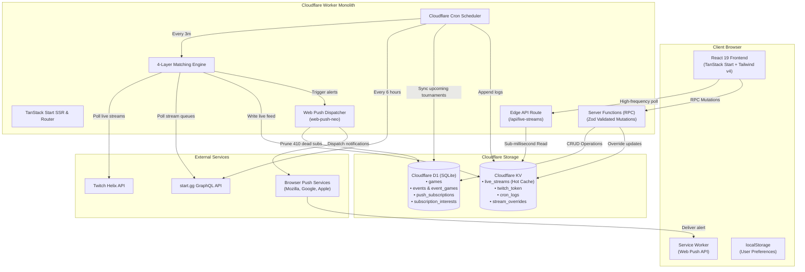

# SetPlay

> **Real-time tournament calendar, automated stream-to-bracket matching, and discoverability platform tailored for the Fighting Game Community (FGC).**

🎮 **Live Demo:** [https://setplay.live](https://setplay.live)

[](https://setplay.live)
[](https://www.typescriptlang.org/)
[](https://tanstack.com/start)
[](https://workers.cloudflare.com/)
[](https://orm.drizzle.team/)
[](https://tailwindcss.com/)
[](https://vitest.dev/)
[](https://playwright.dev/)

---

## The Problem

Fighting game tournaments are vibrant, chaotic, and heavily distributed. During major community events like EVO, Combo Breaker, or regional weeklies:

- Tournaments span **multiple parallel streams** across organizers, community channels, and restreamers.
- Brackets run on **start.gg**, often decoupled from the actual Twitch broadcast titles.
- Viewers frequently jump between Twitter, Discord, and Twitch trying to answer simple questions: _Which stream is Top 8 on right now? Where is the Street Fighter bracket being broadcast?_
- Casual and pro player streams get overshadowed or lost in general Twitch directory feeds.

**SetPlay solves this.** It ingests tournament data and live stream metadata, executes a **4-layer matching engine** to automatically pair active broadcasts with real-time brackets, and surfaces both high-stakes tournament streams and casual fighting game channels in a unified, low-latency dashboard.

---

## Key Features

### 🎯 4-Layer Stream-to-Bracket Matching Engine

SetPlay maps active Twitch broadcasts to ongoing tournaments using a cascading resolution ladder:

1. **Layer 1: start.gg Stream Queue**: Direct API matching against organizers' designated stream assignments.
2. **Layer 2: Known Channel Registry**: Heuristic lookup against curated tournament organizer (TO) channel maps.
3. **Layer 3: Title Pattern & Bracket Stage Regex**: Intelligent regex parsing of stream titles for tournament names, game tags, and tournament stages (_"Top 8"_, _"Pools"_, _"Grand Finals"_).
4. **Layer 4: Casual Discovery Fallback**: Unmatched streams are preserved and categorized as casual or pro streams, maintaining discoverability for the wider FGC without polluting tournament bracket links.

### ⚡ Unified Live Dashboard (`/`)

- **Headline Feature Hero**: Dynamic hero unit spotlighting the premier active tournament stream.
- **Priority-Ordered Stream Feed**: Tournaments are elevated and pinned first, followed by active casual streams.
- **Instant Game Filtering**: Filter live streams by game (Street Fighter 6, Tekken 8, Guilty Gear -Strive-, etc.) with `localStorage` persistence.
- **Compact Tournament Calendar Sidebar**: Ongoing and upcoming tournaments visible alongside the live stream grid.

### 📺 Interactive Watch Experience (`/watch/$streamName`)

- Responsive split-screen view featuring an embedded live Twitch player and collapsible chat sidebar.
- Integrated tournament bracket metadata with direct links to live start.gg brackets.
- Dedicated **Theater Mode** (`t` shortcut or button toggle) for immersive viewing.
- Case-insensitive stream name resolution with offline and fallback support.

### 📅 Tournament Calendar & Directory (`/events`)

- Searchable directory of upcoming, active, and completed tournaments across 19+ supported fighting games.
- Rolling window queries (past 30 days to next 12 months) keeping data fresh and performant.
- Filter by game and tournament status with reverse-chronological sorting for completed events.

### 🔔 Privacy-First Web Push Notifications

- **Zero-Login Architecture**: Users subscribe to specific games or events using the native Web Push API without needing to create an account, enter an email, or manage passwords.
- **VAPID-Backed Alert Dispatcher**: Dispatches browser push notifications when subscribed tournaments or games go live.
- **Self-Healing Subscription Pool**: Automatic detection and pruning of dead endpoints (HTTP 410 Gone) to prevent subscription queue bloat.

### 🛡️ Admin Control Room (`/admin`)

- Token-authenticated control center protected by an in-place security gate.
- **Live Stream Overrides**: Manually link unindexed streams to events, elevate streams to headline status, or adjust priority rankings.
- **Sync-On-Demand**: Trigger manual Twitch and start.gg synchronization.
- **Live KV Cron Inspector**: Real-time structured log buffer displaying background worker activity, timestamps, and error traces.

---

## Architecture & System Design

SetPlay is built as an **Edge-First Serverless Monolith** hosted entirely on **Cloudflare Workers**. It combines server-side rendering, type-safe RPCs, cron triggers, relational storage, and ultra-fast edge caching inside a single unified bundle.



### Key Engineering Invariants

1. **Hot-Path Isolation**: The public client stream feed polls `/api/live-streams`, which serves directly from **Cloudflare KV**. Visitors never touch Cloudflare D1 for live stream feeds, completely protecting the database from high-concurrency read spikes.
2. **Zero Database Writes in Hot Loops**: The 3-minute matching cron job only writes to Cloudflare KV. D1 writes are strictly reserved for the 6-hour tournament sync or direct user mutations (push subscriptions, manual overrides).
3. **Subscription Hygiene**: The push notification engine proactively purges expired or invalidated subscription endpoints upon receiving `410 Gone` responses from browser push services, preventing queue degradation.
4. **Hybrid Communication Model**:
   - **Server Functions (`createServerFn`)**: Used for type-safe, RPC-style client-server operations (push subscriptions, admin actions, game lookups) with Zod boundary validation.
   - **Server Routes (`/api/live-streams`)**: Used for high-throughput public polling with explicit `Cache-Control` and `CDN-Cache-Control` edge headers.

---

## Tech Stack

| Domain                          | Technology                                                                                        | Purpose                                                                                  |
| :------------------------------ | :------------------------------------------------------------------------------------------------ | :--------------------------------------------------------------------------------------- |
| **Framework**                   | [TanStack Start](https://tanstack.com/start) (React 19)                                           | Full-stack SSR framework with file-based routing and seamless server/client boundaries   |
| **Edge Runtime**                | [Cloudflare Workers](https://workers.cloudflare.com/)                                             | Serverless edge execution with zero cold starts                                          |
| **Database**                    | [Cloudflare D1](https://developers.cloudflare.com/d1/) + [Drizzle ORM](https://orm.drizzle.team/) | Serverless SQLite relational database with type-safe schema migrations                   |
| **Hot Cache & Ephemeral State** | [Cloudflare KV](https://developers.cloudflare.com/kv/)                                            | Low-latency edge key-value store for live stream caches, OAuth tokens, and cron logs     |
| **Background Scheduling**       | Cloudflare Worker Crons                                                                           | Dual cron triggers: 3-minute stream matching & 6-hour tournament calendar sync           |
| **Styling & UI**                | [Tailwind CSS v4](https://tailwindcss.com/) + [Lucide React](https://lucide.dev/)                 | Dark-mode only Obsidian & Neon Yellow technical design system                            |
| **Data Validation**             | [Zod](https://zod.dev/)                                                                           | Runtime boundary validation for all external APIs, environment configs, and RPC payloads |
| **Push Notifications**          | Web Push API + `web-push-neo`                                                                     | Zero-login VAPID-authenticated browser push notifications                                |
| **Testing**                     | [Vitest](https://vitest.dev/) & [Playwright](https://playwright.dev/)                             | 44 unit tests (matching, auth, push, startgg, twitch) + 33 E2E integration tests         |
| **Tooling & Build**             | Vite 8, pnpm 11, [oxlint](https://oxc.rs/), [oxfmt](https://oxc.rs/)                              | High-speed bundling, strict linting, and code formatting                                 |

---

## Project Structure

```text
setplay/
├── context/                   # Project specifications and architecture docs
├── drizzle/                   # D1 database migration SQL files
├── public/                    # Static assets & Service Worker (sw.js)
├── src/
│   ├── components/            # Reusable UI components
│   │   ├── AdminGate.tsx      # In-place token authentication gate
│   │   ├── CalendarSidebar.tsx# Tournament sidebar widget
│   │   ├── FeaturedHero.tsx   # Top spotlight tournament stream hero
│   │   ├── GameFilterBar.tsx  # Game filter pills with "+ More" dropdown
│   │   ├── Header.tsx         # Sticky navigation header & brand identity
│   │   ├── StreamCard.tsx     # Responsive stream card with status badges
│   │   └── StreamGrid.tsx     # Responsive live stream grid with tabs
│   ├── context/               # React Context providers (GameFilterContext)
│   ├── hooks/                 # Custom React hooks (push notifications, live streams)
│   ├── routes/                # TanStack Router file-based routes
│   │   ├── __root.tsx         # Root layout shell and HTML document wrapper
│   │   ├── index.tsx          # Main dashboard feed route (/)
│   │   ├── events.tsx         # Tournament directory calendar route (/events)
│   │   ├── watch.$streamName.tsx # Split-screen stream watch view (/watch/:streamName)
│   │   ├── admin.tsx          # Token-protected admin dashboard (/admin)
│   │   └── api/
│   │       └── live-streams.ts# High-throughput public KV cache endpoint
│   ├── server/                # Server-only logic, background jobs & database
│   │   ├── db/
│   │   │   ├── index.ts       # Drizzle D1 client connector
│   │   │   ├── schema.ts      # Relational D1 schema & TypeScript models
│   │   │   └── seed.sql       # Curated FGC game IDs (Twitch + start.gg)
│   │   ├── auth.ts            # Admin session & token validation routines
│   │   ├── cron.ts            # Stream matching (3m) & calendar sync (6h) routines
│   │   ├── matching.ts        # 4-layer stream-to-bracket matching engine
│   │   ├── overrides.ts       # Manual admin stream mapping & priority weights
│   │   ├── push.ts            # VAPID notification dispatch & 410 dead-sub pruning
│   │   ├── startgg.ts         # start.gg GraphQL queries & Zod validators
│   │   └── twitch.ts          # Twitch Helix API client & OAuth token management
│   ├── styles.css             # Obsidian & Neon Yellow Tailwind v4 theme tokens
│   └── tests/                 # Vitest unit test suites (44 tests across 8 suites)
├── tests/
│   └── e2e/                   # Playwright end-to-end test suite (33 tests across 7 specs)
├── wrangler.toml              # Cloudflare Workers, D1, KV, and Cron triggers config
└── vite.config.ts             # Vite 8 config with Cloudflare integration & React HMR
```

---

## Getting Started

> **Note:** Want to explore the app without setting up local API keys or Cloudflare bindings? Visit the live production deployment at **[setplay.live](https://setplay.live)**.

### Prerequisites

- **Node.js**: v20 or higher
- **pnpm**: v11+ (`npm install -g pnpm`)

### 1. Installation

```bash
git clone https://github.com/your-username/setplay.git
cd setplay
pnpm install
```

### 2. Environment Configuration

Create a `.env` or `.dev.vars` file in the root directory:

```ini
# Twitch API credentials (register via dev.twitch.tv)
TWITCH_CLIENT_ID="your_twitch_client_id"
TWITCH_CLIENT_SECRET="your_twitch_client_secret"

# start.gg Personal Access Token (generate via start.gg developer settings)
STARTGG_API_TOKEN="your_startgg_token"

# Web Push VAPID keys (generate via `npx web-push generate-vapid-keys`)
VAPID_PUBLIC_KEY="your_vapid_public_key"
VAPID_PRIVATE_KEY="your_vapid_private_key"
VAPID_SUBJECT="mailto:admin@example.com"

# Admin dashboard security token
ADMIN_TOKEN="your_secure_admin_passphrase"
```

### 3. Local Database Setup

Initialize and seed the local Cloudflare D1 SQLite database:

```bash
# Apply migrations to local D1
pnpm db:migrate:local

# Seed initial fighting games (Twitch & start.gg IDs)
pnpm db:seed:local
```

### 4. Running the Development Server

SetPlay uses `@cloudflare/vite-plugin` to provide native Cloudflare bindings (D1, KV) during local development alongside instant React Fast Refresh:

```bash
pnpm dev
```

Open [http://localhost:3000](http://localhost:3000) in your browser.

---

## Testing & Quality

### Unit Tests (Vitest)

Unit tests cover the 4-layer matching engine, Twitch and start.gg API handlers, Web Push dispatch logic, admin token authentication, and stream resolution:

```bash
# Run all unit tests
pnpm test

# Run unit tests in watch mode
pnpm test:watch
```

### End-to-End Tests (Playwright)

Playwright tests verify complete user journeys across navigation, stream feeds, watch experience, calendar filtering, and admin workflows:

```bash
# Run all Playwright E2E tests
pnpm test:e2e

# Run E2E tests with interactive UI
pnpm test:e2e:ui
```

### Linting & Formatting

Fast, Rust-powered static analysis via [Oxc](https://oxc.rs/):

```bash
# Run linter
pnpm lint

# Check & format code
pnpm format
```

---

## Design System

SetPlay features a custom **Obsidian & Neon Yellow** visual palette tailored specifically for esports and the fighting game community:

- **Base Background**: `#0A0A08` (Deep Obsidian)
- **Surfaces & Cards**: `#141411` (Warm Slate Charcoal)
- **Elevated / Active States**: `#1F1F1A`
- **Subtle Borders**: `#292923`
- **Accent Primary**: `#FFF282` (Neon Pastel Yellow — used sparingly for active tags, live indicators, and CTA outlines)
- **Typography**: `Manrope` for UI & body text; `Fraunces` for editorial display titles.

---

## Deployment

Deploy directly to Cloudflare's global edge network:

```bash
# Configure production secrets
npx wrangler secret put TWITCH_CLIENT_ID
npx wrangler secret put TWITCH_CLIENT_SECRET
npx wrangler secret put STARTGG_API_TOKEN
npx wrangler secret put VAPID_PUBLIC_KEY
npx wrangler secret put VAPID_PRIVATE_KEY
npx wrangler secret put VAPID_SUBJECT
npx wrangler secret put ADMIN_TOKEN

# Deploy Worker bundle, D1 migrations, and client assets
pnpm cf:deploy
```

---

## License

This project is licensed under the [MIT License](LICENSE).
